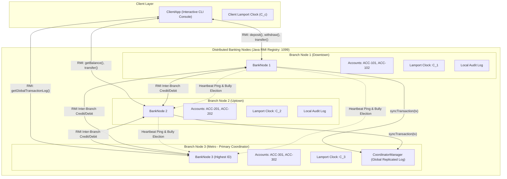
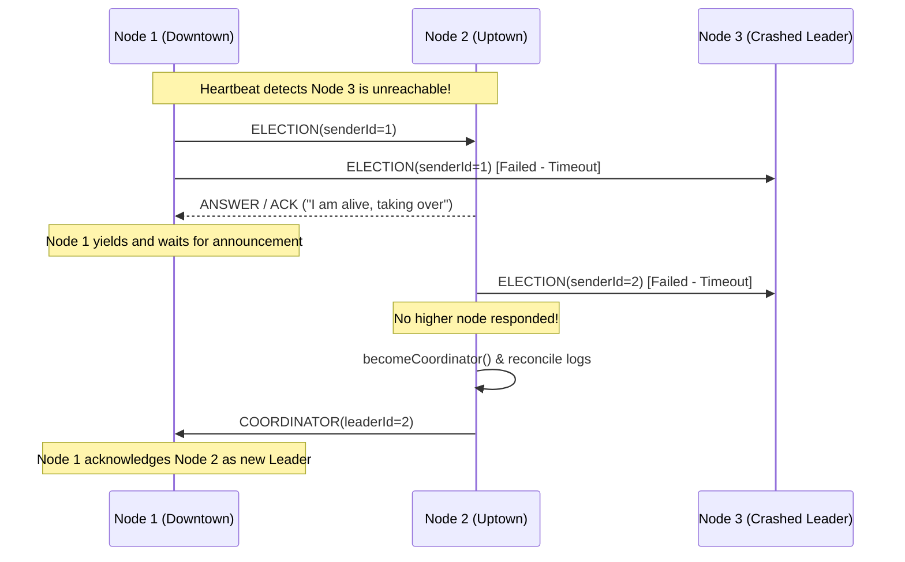

# Distributed Banking System with Multi-Branch Synchronization and Leader Election

**Course:** Final Year B.Tech IT — Distributed Computing Systems Laboratory  
**Technology Stack:** Pure Java 11+ (Standard Library: `java.rmi.*`, `java.util.concurrent.*`, `java.io.*`, `java.net.*`)  
**Zero External Dependencies:** Compiles and runs directly using standard `javac` and `java` commands.

---

## 1. System Architecture & Core Concepts

This project models an enterprise distributed banking network where multiple autonomous bank branches (Downtown, Uptown, Metro) collaborate across network boundaries while guaranteeing strict transactional consistency, causal audit ordering, and automatic fault recovery.



---

## 2. Theoretical Foundations Implemented

### A. Java Remote Method Invocation (RMI)
- **Object Serialization:** Data structures (`Transaction`, `Account`) implement `java.io.Serializable` for marshaling over socket streams.
- **Dynamic Registry Bootstrap:** Embedded RMI registry on port 1099 created by whichever node initializes first (`LocateRegistry.createRegistry`), with graceful fallback to `LocateRegistry.getRegistry` for subsequent nodes.
- **Stub-less Invocations:** Uses modern dynamic proxies (`UnicastRemoteObject`) without requiring legacy `rmic` stub compilers.

### B. Concurrency Control & Deadlock Prevention
- **Reentrant Locks:** Each `Account` employs a fair `java.util.concurrent.locks.ReentrantLock(true)` ensuring First-In-First-Out (FIFO) queueing of competing threads.
- **Deadlock-Free Intra-Branch Transfers:** Lock acquisition order is strictly determined by lexicographical account ID ordering:
  $$\text{lock}(\min(\text{srcId}, \text{tgtId})) \longrightarrow \text{lock}(\max(\text{srcId}, \text{tgtId}))$$
  This prevents the classic dining philosophers cyclic lock wait condition ($T_1: A \to B$ vs $T_2: B \to A$).
- **Distributed Two-Phase Atomic Transfer with Compensating Rollback:**
  1. **Phase 1 (Local Debit):** Lock source account, verify balance, debit funds.
  2. **Phase 2 (Remote Credit):** Call remote branch RMI `internalCredit()`.
  3. **Compensating Action:** If the remote branch is unreachable or throws `RemoteException`, local funds are immediately credited back (rolled back), preserving global money invariants.

### C. Lamport's Logical Clock & Total Causal Ordering
Distributed physical clocks suffer from clock drift and network jitter (NTP skew). Leslie Lamport's logical clock algorithm enforces a strict "happens-before" ($\to$) relation:

1. **Local Event / Before Send:**
   $$C_i = C_i + 1$$
   Every transaction attaches the current timestamp $T_m = C_i$ to the message.
2. **Message Receive Event:**
   Upon receiving timestamp $T_{msg}$:
   $$C_j = \max(C_j, T_{msg}) + 1$$
3. **Total Order Tie-Breaking:**
   For any two events $a$ (at Node $i$) and $b$ (at Node $j$):
   $$a \prec b \iff (C_i(a) < C_j(b)) \lor (C_i(a) = C_j(b) \land i < j)$$
   This guarantees that all nodes reconstruct an identical causal sequence in the global audit log.

### D. Bully Leader Election Algorithm
Dynamically elects the active branch node with the highest ID to act as Primary Coordinator:



1. **Failure Detection:** Non-leader nodes send periodic heartbeat pings (`pingLeader()`) every 3 seconds.
2. **Election Initiation:** If the coordinator fails to respond, node $P_i$ sends `electLeader(i)` to all $P_j$ where $j > i$.
3. **Takeover:** If any $P_j$ responds with ACK, $P_i$ yields and waits for a victory announcement.
4. **Victory Proclamation:** If no higher nodes respond, $P_i$ crowns itself, assumes `CoordinatorManager` duties, reconciles all branch audit logs, and broadcasts `announceLeader(i)` to all nodes with $k < i$.

---

## 3. Directory Structure

```
distributed-banking-system/
├── Account.java               # Thread-safe account model with fair ReentrantLocks
├── BankInterface.java         # RMI Remote interface (Banking, Sync, Bully protocol)
├── BankNode.java              # Branch server implementation, Lamport clock & Bully engine
├── ClientApp.java             # Interactive CLI client with concurrency benchmark
├── WebDashboard.java          # Zero-dependency Web GUI Dashboard server (Port 8080)
├── CoordinatorManager.java    # Coordinator replicated audit log & multi-branch sync
├── LamportClock.java          # Thread-safe Lamport logical clock implementation
├── Transaction.java           # Immutable transaction record with Lamport total ordering
├── ClusterSimulation.java     # Automated test harness for single-command verification
├── build.bat                  # Windows batch script to compile all classes
├── start-web-dashboard.bat    # One-click launcher for Web GUI Dashboard (http://localhost:8080)
├── start-node1.bat            # Windows launcher for Branch Node 1 (Downtown)
├── start-node2.bat            # Windows launcher for Branch Node 2 (Uptown)
├── start-node3.bat            # Windows launcher for Branch Node 3 (Metro)
├── start-client.bat           # Windows launcher for ClientApp
└── run-simulation.bat         # Windows launcher for ClusterSimulation
```

---

## 4. Compilation & Multi-Terminal Execution Guide

### Prerequisites
- JDK 11 or higher installed (`javac -version`, `java -version`).

### Step 1: Compile All Sources
Open a terminal in the project directory:
```bash
javac *.java
```

---

### Step 2: Launch Branch Nodes in Separate Terminals

#### Terminal 1 — Start Branch Node 1 (Downtown Branch)
```bash
java BankNode 1 "Downtown Branch" 1099
```
*Note: Because Node 3 is not yet running, Node 1 initiates election and temporarily serves until higher nodes arrive.*

#### Terminal 2 — Start Branch Node 2 (Uptown Branch)
```bash
java BankNode 2 "Uptown Branch" 1099
```
*Note: Node 2 has higher ID than Node 1; it triggers election and temporarily takes over leadership.*

#### Terminal 3 — Start Branch Node 3 (Metro Branch — Highest ID = Coordinator)
```bash
java BankNode 3 "Metro Branch" 1099
```
*Note: Node 3 has the highest ID in the cluster (3). It takes over as Primary Coordinator and broadcasts victory.*

---

### Step 3: Run Interactive Client Console

#### Terminal 4 — Start ClientApp
```bash
java ClientApp 1 1099
```

### Pre-Seeded Accounts for Testing:
| Account ID | Branch Node | Owner Name | Initial Balance |
| :--- | :--- | :--- | :--- |
| **ACC-101** | Node 1 (Downtown) | Alice Downtown | $1,500.00 |
| **ACC-102** | Node 1 (Downtown) | Bob Downtown | $2,800.00 |
| **ACC-201** | Node 2 (Uptown) | Charlie Uptown | $2,200.00 |
| **ACC-202** | Node 2 (Uptown) | Diana Uptown | $3,500.00 |
| **ACC-301** | Node 3 (Metro) | Evan Metro | $1,900.00 |
| **ACC-302** | Node 3 (Metro) | Fiona Metro | $4,200.00 |

---

### Step 4: Step-by-Step Lab Demonstration

1. **Balance Check:**
   - In Terminal 4 (`ClientApp`), select Option `1`.
   - Enter `ACC-101`. Observe the balance ($1500.00) and the incrementing Client Lamport timestamp.
2. **Cross-Branch Atomic Transfer:**
   - Select Option `4`.
   - From: `ACC-101` (Node 1), To: `ACC-201` (Node 2), Amount: `300`.
   - Observe Terminal 1 (debit applied) and Terminal 2 (credit applied).
3. **Verify Total Causal Order in Global Log:**
   - Select Option `6` to view the global log on the Coordinator.
   - Notice transactions are strictly ordered by `[L-Timestamp, Node ID]`.
4. **Concurrency Stress Test (Option 9):**
   - Spawns 10 concurrent threads (5 depositing $50, 5 withdrawing $50 simultaneously).
   - Proves zero race conditions with net balance change exactly equal to $0.00.
5. **Simulate Leader Crash & Automatic Bully Election:**
   - Go to **Terminal 3** (Node 3) and press **`Ctrl + C`** to kill the coordinator.
   - Watch **Terminal 2** (Node 2) and **Terminal 1** (Node 1):
     - Within 3 seconds, the heartbeat detector spots Node 3 is down.
     - Node 1 sends `ELECTION` to Node 2.
     - Node 2 answers with ACK, pings Node 3 (fails), and proclaims VICTORY!
     - Node 2 reconciles global transaction logs and becomes the new Coordinator.
   - In Terminal 4 (`ClientApp`), select Option `7` to confirm Node 2 is now the active Leader!
   - Perform a deposit or transfer to prove the cluster continues running with zero data loss!

---

### Option 6: Launch Modern Web GUI Dashboard (One-Click Visualizer)
You can launch the complete visual dashboard in a single command:
```bash
java -cp . WebDashboard 8080
```
*(Or double-click `start-web-dashboard.bat`)*

Then open your browser at:  
👉 **`http://localhost:8080`**

**Web GUI Capabilities:**
- **Live Branch Topology:** Real-time cards for Branch 1 (Downtown), Branch 2 (Uptown), and Branch 3 (Metro) showing live account balances and pulsing Lamport logical clock counters.
- **Dynamic Leader Visualizer:** The elected primary branch automatically wears the golden **`👑 COORDINATOR`** badge.
- **Interactive Banking Studio:** Perform direct deposits, withdrawals, and cross-branch transfers with immediate feedback and Lamport receipt updates.
- **Failure Simulator:** Click **"Kill Node 3"** to simulate a crash and watch Node 2 or Node 1 initiate the Bully election and claim the Coordinator crown live! Click **"Revive"** to bring it back.
- **10-Thread Stress Test:** One-click button to run concurrent deposit/withdraw threads and verify zero race conditions.
- **Synchronized Global Audit Ledger:** Live updating table displaying all committed transactions in Lamport total causal order.

---

## 5. Lab Viva / Oral Examination Q&A

**Q1: Why do we need Lamport's Logical Clock instead of System.currentTimeMillis()?**  
*Answer:* In distributed systems, individual physical clocks experience drift and NTP synchronization latency. If two transactions occur within milliseconds on different servers, physical timestamps can misrepresent the actual causal order (e.g., an effect could appear with a timestamp earlier than its cause). Lamport's Logical Clock guarantees that if event $A \to B$ ($A$ causally influences $B$), then $L(A) < L(B)$.

**Q2: How does the Bully Algorithm handle simultaneous election requests?**  
*Answer:* If Node 1 and Node 2 simultaneously detect coordinator failure, both send election messages. Because Node 2 has a higher ID than Node 1, Node 2 sends an "OK/ACK" message to Node 1, forcing Node 1 to yield. Node 2 then contacts nodes higher than itself. Since none exist or respond, Node 2 wins and broadcasts the COORDINATOR announcement, eliminating split-brain scenarios.

**Q3: How are race conditions avoided when multiple users access the same bank account concurrently?**  
*Answer:* Each `Account` object encapsulates a fair `ReentrantLock(true)`. All deposit, withdraw, and balance inspection operations must acquire this lock before mutating state. For intra-branch transfers involving two accounts, deadlock is prevented by enforcing strict alphabetical lock acquisition order.

**Q4: What happens if a network partition occurs during a cross-branch transfer?**  
*Answer:* The system implements a distributed two-phase atomic operation with compensating rollback: Node 1 debits local account $A$. If the remote RMI call to credit account $B$ on Node 2 fails due to a network partition (`RemoteException`), Node 1 catches the exception and immediately invokes a compensating local deposit, restoring the original balance.
